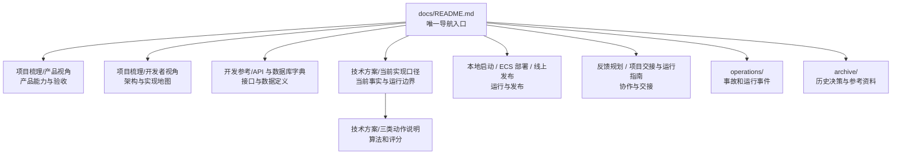

# Home Rehab Motion 文档导航

> 文档基线：2026-10-23。先从本页进入，不要以文件名、修改时间或 `archive/` 中的方案推断当前实现。当前事实以代码、数据库结构、运行时快照和本页标记为准。

## 1. 阅读入口

| 你要解决的问题 | 首选文档 | 说明 |
| --- | --- | --- |
| 项目做什么、产品能做什么、患者会看到什么 | [产品视角：产品能力与用户旅程](项目梳理/产品视角_产品能力与用户旅程.md) | 患者/管理端功能、状态—话术、激励与验收闭环 |
| 系统怎么组成、从哪里开始开发 | [开发者视角：系统架构与实现地图](项目梳理/开发者视角_系统架构与实现地图.md) | 服务边界、数据流、模块、数据模型与修改清单 |
| 要查接口、请求契约或数据库字段 | [API 与数据库字典](开发参考/API与数据库字典.md) | 全量路由、权限、DTO 来源、Prisma 表字段与关系 |
| 当前产品和实现到底以什么为准 | [当前实现口径](技术方案/当前实现口径.md) | 业务规则、正式分析路径、版本和配置边界 |
| 三类动作如何切分和评分 | [三类康复动作拆分、分析与评分说明](技术方案/三类康复动作拆分分析评分说明.md) | 正式/影子/回退算法路径及模板边界 |
| 本地如何启动与排错 | [本地启动运行指南](本地启动运行指南.md) | 本地依赖、端口、启动、验证 |
| 单机 ECS 如何发布 | [阿里云 ECS 发布部署操作手册](阿里云ECS发布部署操作手册.md) | 当前仓库的单机部署基线 |
| 发布安全、灰度、回滚应满足什么原则 | [线上发布运行指南](线上发布运行指南.md) | 目标级规范；不能替代实际 Compose/环境变量 |
| 训练反馈如何流转 | [训练反馈工单](反馈规划.md) | 当前工单类型、状态、安全分流和产品边界 |
| 交接、已知风险和运行注意事项 | [项目交接与运行指南](项目交接与运行指南.md) | 面向接手开发/运维的摘要 |
| 教学/算法验证视频如何管理 | [视频资产说明](视频资产说明.md) | 保留范围、用途、隐私与提交边界 |

## 2. 当前文档体系

### 2.1 文件角色

| 分区 | 应存放的内容 | 不应存放的内容 |
| --- | --- | --- |
| `项目梳理/` | 面向开发、产品的稳定总览 | 逐次试验记录、接口全量清单 |
| `开发参考/` | API、DTO、数据库等可检索的技术字典 | 产品规则、架构总览或运行手册 |
| `技术方案/` | 当前规则、算法、明确的后续规划 | 已结束方案、旧口径和旧截图 |
| `operations/` | 有日期的事故、复盘、运行证据 | 通用发布步骤 |
| 根目录 `docs/` | 启动、部署、反馈、交接等跨领域操作文档 | 新的无归属“整体梳理” |
| `archive/` | 已替代方案、PRD、旧 UI、旧配置和外部资料 | 当前唯一事实来源 |

## 3. 文档维护规则

1. 一条当前事实只维护一个**规范来源**；其他文档链接过去，不复制完整规则。
2. 改接口、状态、数据模型或算法时，同步检查“当前实现口径”和对应专题文档；只有面向患者的展示变化才同步产品视角。
3. 每份当前文档开头写明基线日期、适用范围、权威来源和不适用边界。
4. 已被替代的方案移入 `archive/`，并在文件开头写清“替代者”和归档原因；不改写其历史结论。
5. 视频、患者样本、临时调试产物不作为文档提交。教学视频/样例如需留存，应进入对象存储或 Git LFS，并在文档中只保留受控引用和用途说明。
6. 新增文档前先判断能否扩展现有规范来源；不能时才创建，并在本页登记。

## 4. 保留资产

`docs/video/`、`docs/标准教学视频/` 是保留的本地教学/算法验证资产，不参与本次文档清理；具体边界见[视频资产说明](视频资产说明.md)。

