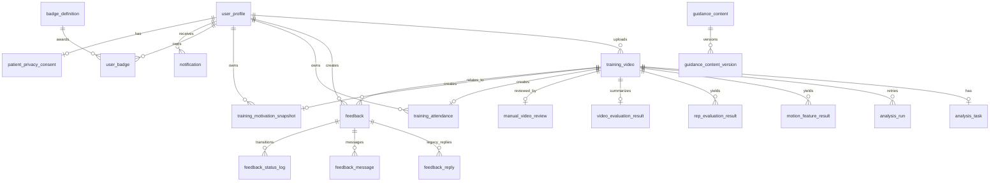

# API 与数据库字典

> 基线：2026-10-26。本文根据 `services/main-service` Controller、`packages/shared-contract` 与 `services/main-service/prisma/schema.prisma` 整理。  
> 适用范围：主服务公网 API、分析服务内部 API，以及 MySQL 的 Prisma 模型。Controller、DTO 和 Schema 是最终事实来源；改代码时必须同步更新本文。

## 1. 使用约定

### 1.1 API 基址与认证

- 主服务基址：`/api`，例如 `GET /api/guidance`。
- 患者/管理端受保护接口使用 `Authorization: Bearer <token>`；权限列中的 `P`、`N`、`A` 分别表示 `patient`、`nurse`、`admin`。
- 内部分析接口使用 `X-Internal-Token`，不得暴露给小程序或管理端浏览器。
- 主服务成功响应统一封装为 `{ success: true, data }`。参数校验、找不到资源等预期业务错误也可能返回 HTTP 200，但响应为 `{ success: false, code, message, path, timestamp }`；认证/授权和服务异常保留真实 HTTP 状态。
- 分析服务不使用主服务响应包装，直接返回 FastAPI 的 JSON/HTTP 状态。

### 1.2 契约与状态来源

| 内容 | 权威位置 |
| --- | --- |
| 主服务请求/响应 DTO | `packages/shared-contract/src/index.ts` |
| 动作、分析、反馈、角色等枚举 | `packages/shared-types/src/index.ts` |
| 路由、权限、参数校验 | `services/main-service/src/**/*.controller.ts` |
| 数据库字段、约束、关系 | `services/main-service/prisma/schema.prisma` |
| 分析服务请求/响应模型 | `services/analysis-service/app/schemas/analysis.py` |

## 2. 主服务 API：认证与健康检查

| 方法 | 路径 | 权限 | 输入 | 输出/用途 |
| --- | --- | --- | --- | --- |
| `POST` | `/api/auth/mock-login/status` | 公开 | — | 本地 Mock 登录是否启用 |
| `POST` | `/api/auth/mock-login` | 公开（仅本地配置允许） | — | Mock 患者登录结果 |
| `POST` | `/api/auth/wx-login` | 公开 | `WxLoginRequestDto` | 微信登录，返回 `WxLoginResponseDto` |
| `POST` | `/api/auth/wx-phone-login` | 公开 | `WxPhoneLoginRequestDto` | 微信手机号登录 |
| `POST` | `/api/admin/auth/login` | 公开 | `AdminLoginRequestDto` | 管理账号登录，返回 `AdminLoginResponseDto` |
| `GET` | `/api/health` | 公开 | — | 基础健康信息 |
| `GET` | `/api/health/live` | 公开 | — | 存活探针 |
| `GET` | `/api/health/ready` | 公开 | — | 就绪探针（依赖检查） |

## 3. 主服务 API：患者端

### 3.1 指导内容、资料、隐私与通知

| 方法 | 路径 | 权限 | 输入 | 输出/用途 |
| --- | --- | --- | --- | --- |
| `GET` | `/api/guidance` | P/A/N | — | 已启用指导内容列表 |
| `GET` | `/api/guidance/by-action/:actionType` | P/A/N | `actionType` | 指定动作的指导内容 |
| `GET` | `/api/guidance/assets` | 公开 | Query：`key` | 指导素材代理读取，支持 Range 请求 |
| `GET` | `/api/guidance/:contentId` | P/A/N | `contentId` | 指导详情 |
| `GET` | `/api/me/profile` | P | — | `UserProfileDto` |
| `PUT` | `/api/me/profile` | P | `UpdatePatientProfileRequestDto` | 更新患者资料 |
| `POST` | `/api/me/phone/bind` | P | `BindWechatPhoneRequestDto` | 绑定微信手机号 |
| `GET` | `/api/me/display-settings` | P | — | `DisplaySettingsDto` |
| `PUT` | `/api/me/display-settings` | P | `UpdateDisplaySettingsRequestDto` | 更新长者/标准显示模式 |
| `GET` | `/api/me/app-config` | P | — | `PatientAppConfigDto` |
| `GET` | `/api/me/privacy/consent` | P | — | 隐私授权状态 |
| `POST` | `/api/me/privacy/consent` | P | — | 授予视频分析授权 |
| `POST` | `/api/me/privacy/withdraw-consent` | P | — | 撤回授权，后续上传/分析受限 |
| `GET` | `/api/notifications` | P | — | 通知列表 |
| `GET` | `/api/notifications/unread-count` | P | — | 未读数量 |
| `PATCH` | `/api/notifications/:notificationId/read` | P | `notificationId` | 标为已读 |
| `POST` | `/api/notifications/:notificationId/read` | P | `notificationId` | 标为已读的兼容入口 |
| `POST` | `/api/notifications/read-all` | P | — | 全部标为已读 |

### 3.2 上传、分析、报告与历史

| 方法 | 路径 | 权限 | 输入 | 输出/用途 |
| --- | --- | --- | --- | --- |
| `GET` | `/api/videos/presign-upload` | P | Query：`actionType`、`duration`、`fileSizeBytes` | 创建上传目标，返回 `PresignUploadResponseDto` |
| `POST` | `/api/videos/:videoId/upload` | P | `multipart/form-data`：`file`，上限 200 MiB | `local_proxy` 模式下经主服务上传文件 |
| `POST` | `/api/videos/confirm-upload` | P | `ConfirmUploadRequestDto` | 校验对象并投递分析，返回状态与等待提示 |
| `GET` | `/api/videos/:videoId/status` | P | `videoId` | `VideoStatusDto`，用于轮询排队/分析/报告状态 |
| `GET` | `/api/reports/:videoId` | P | `videoId` | 当前患者可见训练报告 |
| `GET` | `/api/history/videos` | P | Query：`page`、`pageSize≤50` | 训练视频历史 |
| `POST` | `/api/me/self-training` | P | Body：`actionType?` | 创建自主练习记录（同日限制） |
| `GET` | `/api/me/self-training` | P | Query：`page`、`pageSize≤50` | 自主练习记录列表 |
| `GET` | `/api/me/self-training/:id` | P | `id` | 单条自主练习记录 |

### 3.3 训练激励与徽章

| 方法 | 路径 | 权限 | 输入 | 输出/用途 |
| --- | --- | --- | --- | --- |
| `GET` | `/api/me/training-summary` | P | — | 训练次数、训练日、阶段、周进度、趋势与鼓励信息 |
| `GET` | `/api/me/badges` | P | — | 已获徽章 |
| `GET` | `/api/me/badge-wall` | P | — | 徽章墙及最近目标 |
| `POST` | `/api/me/badges/:badgeCode/seen` | P | `badgeCode` | 标记徽章已读 |

### 3.4 患者反馈

| 方法 | 路径 | 权限 | 输入 | 输出/用途 |
| --- | --- | --- | --- | --- |
| `GET` | `/api/feedback/presign-upload` | P | Query：`fileName?` | 获取反馈图片上传目标 |
| `POST` | `/api/feedback/upload-image` | P | `multipart/form-data`：`file≤5MiB`、`objectKey` | 本地代理上传反馈图片 |
| `POST` | `/api/feedback` | P | `CreateFeedbackRequestDto` | 新建反馈工单 |
| `GET` | `/api/feedback` | P | — | 当前患者反馈列表 |
| `GET` | `/api/feedback/:feedbackId` | P | `feedbackId` | 当前患者的反馈详情/消息流 |
| `POST` | `/api/feedback/:feedbackId/messages` | P | Body：`content?`、`imageUrls?` | 患者追加消息 |

## 4. 主服务 API：管理端

### 4.1 患者、账号与看板

| 方法 | 路径 | 权限 | 输入 | 输出/用途 |
| --- | --- | --- | --- | --- |
| `GET` | `/api/admin/patients` | A/N | Query：`keyword`、`page`、`limit` | 患者分页列表 |
| `GET` | `/api/admin/patients/:patientId` | A/N | `patientId` | 患者详情；记录敏感访问审计 |
| `GET` | `/api/admin/accounts` | A/N | — | 管理账号列表 |
| `POST` | `/api/admin/accounts` | A/N | `username`、`password≥8`、`role?`、`displayName?` | 新建账号（角色默认 nurse） |
| `PATCH` | `/api/admin/accounts/:accountId` | A/N | `role?`、`status?`、`displayName?` | 更新账号；不可降权/禁用自身 |
| `PATCH` | `/api/admin/accounts/:accountId/password` | A/N | `password≥8` | 重置密码 |
| `DELETE` | `/api/admin/accounts/:accountId` | A/N | `accountId` | 删除无关联操作记录的账号；自身不可删 |
| `GET` | `/api/videos/admin/dashboard-overview` | A/N | Query：`days?` | 分析与训练看板概览 |
| `GET` | `/api/videos/admin/analysis-health` | A/N | — | 主服务视角的分析服务健康信息 |

### 4.2 指导内容与素材

| 方法 | 路径 | 权限 | 输入 | 输出/用途 |
| --- | --- | --- | --- | --- |
| `GET` | `/api/admin/guidance` | A/N | — | 管理端指导列表 |
| `POST` | `/api/admin/guidance` | A/N | `GuidanceContentDto` | 创建指导内容/版本 |
| `GET` | `/api/admin/guidance/:id` | A/N | `id` | 指导详情与当前版本 |
| `PUT` | `/api/admin/guidance/:id` | A/N | `GuidanceContentDto` | 保存更新内容/版本 |
| `POST` | `/api/admin/guidance/:id/enabled` | A/N | Body：启用状态 | 启用或下线患者端可见内容 |
| `POST` | `/api/admin/guidance/:id/copy` | A/N | `id` | 复制指导内容 |
| `DELETE` | `/api/admin/guidance/:id` | A/N | `id` | 删除指导内容 |
| `GET` | `/api/admin/guidance/config-package` | A/N | — | 导出指导内容配置包 |
| `POST` | `/api/admin/guidance/config-package/import` | A/N | 配置包 JSON | 导入指导内容配置包 |
| `GET` | `/api/admin/guidance/presign-upload` | A/N | Query：文件元信息 | 获取指导素材上传目标 |
| `POST` | `/api/assets/upload` | A/N | `multipart/form-data`：`file≤20MiB`、`objectKey` | 本地代理上传指导素材 |

### 4.3 视频、人工复核与内部样本

| 方法 | 路径 | 权限 | 输入 | 输出/用途 |
| --- | --- | --- | --- | --- |
| `GET` | `/api/videos/admin/list` | A/N | Query：`page`、`limit`、`status?`、`keyword?` | 患者训练视频分页列表 |
| `GET` | `/api/videos/admin/tasks` | A/N | Query：`page`、`limit`、`status?`、`keyword?` | 异步分析任务列表 |
| `GET` | `/api/videos/admin/:videoId` | A/N | `videoId` | 视频详情；记录敏感访问审计 |
| `GET` | `/api/videos/admin/:videoId/analysis-detail` | A/N | `videoId` | 分析运行、特征、评分详情；记录审计 |
| `GET` | `/api/videos/admin/:videoId/keypoints` | A/N | `videoId` | 关键点/骨架预览；记录审计 |
| `GET` | `/api/videos/admin/:videoId/manual-review` | A/N | `videoId` | 人工复核结果；记录审计 |
| `POST` | `/api/videos/admin/:videoId/manual-review` | A/N | `SaveManualVideoReviewRequestDto` | 保存人工复核 |
| `POST` | `/api/videos/admin/:videoId/reanalyze` | A/N | `videoId` | 创建新的分析运行并重新投递 |
| `GET` | `/api/videos/admin/internal-samples/:sourceType/presign-upload` | A | `sourceType`：`admin_flow_verify` / `gold_template`；Query：`actionType` | 内部样本上传目标 |
| `POST` | `/api/videos/admin/internal-samples/:videoId/upload` | A | `multipart/form-data`：`file≤200MiB` | 代理上传内部样本 |
| `POST` | `/api/videos/admin/internal-samples/:videoId/confirm-upload` | A | `ConfirmUploadRequestDto` | 确认并分析内部样本 |
| `GET` | `/api/videos/admin/internal-samples/:videoId/status` | A | `videoId` | 内部样本状态 |

### 4.4 阈值、模板、患者配置与激励

| 方法 | 路径 | 权限 | 输入 | 输出/用途 |
| --- | --- | --- | --- | --- |
| `GET` | `/api/admin/thresholds` | A/N | — | 当前动作阈值列表 |
| `PUT` | `/api/admin/thresholds/:actionType` | A/N | 阈值配置、`changeSummary?`、`activate?`、`parentTemplateId?` | 创建阈值版本，可选择启用 |
| `GET` | `/api/admin/thresholds/gold-templates/source-videos` | A | Query：`actionType?` | 可作为金标准来源的内部样本 |
| `GET` | `/api/admin/thresholds/gold-templates` | A/N | Query：`actionType?`、`status?`、`page?`、`pageSize?` | 金标准/阈值版本列表 |
| `POST` | `/api/admin/thresholds/gold-templates/generate` | A | `GoldTemplateGenerateRequestDto` | 从样本生成候选模板 |
| `POST` | `/api/admin/thresholds/gold-templates` | A | `GoldTemplateSaveRequestDto` | 保存模板版本 |
| `GET` | `/api/admin/thresholds/gold-templates/:templateId` | A/N | `templateId` | 模板版本详情 |
| `PUT` | `/api/admin/thresholds/gold-templates/:templateId/status` | A/N | `GoldTemplateVersionStatusUpdateRequestDto` | 启用/停用模板版本 |
| `PUT` | `/api/admin/thresholds/gold-templates/:templateId/archive` | A/N | `templateId` | 归档模板版本 |
| `DELETE` | `/api/admin/thresholds/gold-templates/:templateId` | A/N | `templateId` | 删除符合条件的模板版本 |
| `GET` | `/api/admin/thresholds/motivation-rules` | A/N | — | 当前 6 个激励阈值 |
| `PUT` | `/api/admin/thresholds/motivation-rules` | A/N | `Partial<MotivationRulesDto>` | 更新激励阈值（只影响后续结果） |
| `GET` | `/api/admin/thresholds/patient-app-config` | A/N | — | 患者端配置 |
| `PUT` | `/api/admin/thresholds/patient-app-config` | A/N | `UpdatePatientAppConfigRequestDto` | 更新患者端配置 |

### 4.5 管理端反馈

| 方法 | 路径 | 权限 | 输入 | 输出/用途 |
| --- | --- | --- | --- | --- |
| `GET` | `/api/admin/feedback` | A/N | Query：`keyword?`、`page?`、`limit?` | 全量反馈工单列表 |
| `GET` | `/api/admin/feedback/safety-records` | A/N | Query：同上 | 仅身体不适/安全分流记录 |
| `GET` | `/api/admin/feedback/reply-templates` | A/N | — | 回复模板 |
| `GET` | `/api/admin/feedback/:feedbackId` | A/N | `feedbackId` | 工单详情；记录敏感访问审计 |
| `POST` | `/api/admin/feedback/:feedbackId/start` | A/N | `feedbackId` | 开始处理工单 |
| `POST` | `/api/admin/feedback/:feedbackId/reply` | A/N | `content?`、`templateCode?` | 回复工单 |
| `POST` | `/api/admin/feedback/:feedbackId/close` | A/N | `feedbackId` | 以 `no_further_response_needed` 原因关闭工单 |
| `POST` | `/api/admin/feedback/batch-close` | A/N | — | 按服务端规则批量关闭符合条件的工单 |

### 4.6 内部回调

| 方法 | 路径 | 权限 | 输入 | 输出/用途 |
| --- | --- | --- | --- | --- |
| `POST` | `/api/videos/internal/analysis-callback` | `X-Internal-Token` | 分析状态、质量结果、`video_evaluation`、运行 ID | 分析 Worker 回写主服务；严禁由客户端调用 |

## 5. 分析服务内部 API

> 分析服务默认基址为 `http://analysis-service:8000`（本地为 `http://127.0.0.1:8000`）。`/analysis/*` 都要求 `X-Internal-Token`。

| 方法 | 路径 | 输入 | 输出/用途 |
| --- | --- | --- | --- |
| `GET` | `/` | — | 服务名称、版本和基础状态 |
| `GET` | `/health`、`/health/` | — | 基础健康检查 |
| `GET` | `/health/live` | — | 存活检查 |
| `GET` | `/health/ready` | — | MySQL 与 Redis 就绪检查 |
| `POST` | `/analysis/submit` | `AnalyzeRequest`：`video_id`、`action_type`、`video_key?`、`analysis_run_id?`、`sample_fps?`、`threshold_config?` | 入队，返回 `AnalyzeResponse`；重复活跃任务会去重 |
| `GET` | `/analysis/status?video_id=` | `video_id` | `TaskStatusResponse`，含任务状态和完成时的摘要评分 |
| `GET` | `/analysis/keypoints?video_id=` | `video_id` | `KeypointsResponse`，骨架帧及动作分段；供管理端预览 |
| `GET` | `/analysis/result?video_id=` | `video_id` | `AnalysisResultResponse`，完整质量、视频/Rep 评分与特征 |

## 6. 数据库总览

字段类型以 Prisma Schema 为准。以下字段清单中：`PK` 为主键，`FK` 为关系字段，`UQ` 为唯一约束；`?` 表示可空。`created_at`、`updated_at` 是审计时间，除非另列含义，不应被业务逻辑覆盖。

### 6.1 用户、账号、隐私与审计

| 表（模型） | 主键/约束 | 业务字段 | 关系与用途 |
| --- | --- | --- | --- |
| `user_profile` (`UserProfile`) | PK `user_id`；UQ `openid`；索引 `role` | `openid`、`name?`、`gender?`、`age?`、`phone?`、`phone_authorized_at?`、`role`、`status`、`display_mode`、`created_at`、`updated_at` | 患者主体；关联视频、训练日、激励、反馈、徽章、通知和隐私授权 |
| `admin_account` (`AdminAccount`) | PK `account_id`；UQ `username` | `username`、`password_hash`、`display_name?`、`role`、`status`、`created_at`、`updated_at` | 管理端身份；密码只保存 scrypt 哈希 |
| `patient_privacy_consent` (`PatientPrivacyConsent`) | PK `consent_id`；UQ/FK `user_id`；索引 `consented_at` | `policy_version`、`consented_at?`、`withdrawn_at?`、时间字段 | 一位患者一条隐私授权记录 |
| `sensitive_access_audit` (`SensitiveAccessAudit`) | PK `audit_id`；索引 `(patient_id, created_at)`、`(actor_account_id, created_at)` | `actor_account_id?`、`actor_role`、`action`、`resource_type`、`resource_id`、`patient_id?`、`request_ip?`、`user_agent?`、`result`、`created_at` | 敏感患者/视频/反馈读取审计；当前无 Prisma 关系约束 |

### 6.2 指导内容

| 表（模型） | 主键/约束 | 业务字段 | 关系与用途 |
| --- | --- | --- | --- |
| `guidance_content` (`GuidanceContent`) | PK `content_id`；索引 `action_type` | `action_type`、`title`、`brief_instruction?`、`description?`、`video_key?`、`video_url?`、`thumbnail_url?`、`text_instruction?`、`common_mistakes?`、`shooting_requirement?`、`step_images?`、`shooting_guide_images?`、`common_mistake_images?`、`status`、`version`、`published_version?`、`draft_snapshot?`、`created_by?`、`updated_by?`、时间字段 | 动作指导主记录；`status`/`published_version` 决定患者端可见版本 |
| `guidance_content_version` (`GuidanceContentVersion`) | PK `version_id`；FK `content_id`；UQ `(content_id, version)` | `version`、`snapshot?`、`created_by?`、`created_at` | 指导内容版本快照；`snapshot` 对应 `GuidanceContentDto` 语义 |

### 6.3 视频、异步分析与评分结果

| 表（模型） | 主键/约束 | 业务字段 | 关系与用途 |
| --- | --- | --- | --- |
| `training_video` (`TrainingVideo`) | PK `video_id`；FK `user_id`；索引 `user_id`、`analysis_status` | `action_type`、`source_type?`、`video_key?`、`video_key_720p?`、`duration?`、`upload_size_bytes?`、`resolution?`、`upload_time`、`confirmed_at?`、`short_clip`、`analysis_status`、`quality_status?`、`quality_score?`、`quality_issues?`、`fail_reason?`、`model_version?`、时间字段 | 训练/内部样本原始记录；一对一任务、视频报告、人工复核、训练日和激励快照 |
| `analysis_task` (`AnalysisTask`) | PK `task_id`；UQ/FK `video_id`；索引 `analysis_run_id` | `provider_task_id?`、`analysis_run_id?`、`task_status`、`progress_stage?`、`retry_count`、`manual_retry_count`、`fail_reason?`、`callback_status`、`callback_attempt_count`、`callback_last_error?`、`callback_next_retry_at?`、`callback_payload?`、`callback_url?`、`started_at?`、`finished_at?`、时间字段 | 当前视频的异步任务状态与回调补偿记录 |
| `analysis_run` (`AnalysisRun`) | PK `analysis_run_id`；FK `video_id`；索引 `(video_id, created_at)`、`status` | `provider_task_id?`、`status`、`request_snapshot?`、`algorithm_version?`、`template_version?`、`threshold_version?`、`fail_reason?`、`started_at?`、`finished_at?`、时间字段 | 每一次分析运行的可追溯快照；重分析新增记录，不覆盖历史 |
| `motion_feature_result` (`MotionFeatureResult`) | PK `id`；FK `video_id`；索引 `video_id` | `rep_id?`、`feature_code`、`feature_value?`、`unit?`、`confidence?`、`compare_label?`、`deviation_sigma?`、`created_at` | Rep/视频特征明细，用于模板比对与诊断 |
| `rep_evaluation_result` (`RepEvaluationResult`) | PK `id`；FK `video_id`；索引 `video_id` | `rep_id`、`accuracy_score?`、`stability_score?`、`control_score?`、`duration_score?`、`total_score?`、`grade?`、`valid_flag`、`compensation_types?`、`hold_duration?`、`created_at` | 单周期评分结果 |
| `video_evaluation_result` (`VideoEvaluationResult`) | PK/FK `video_id`；索引 `template_id` | `total_reps`、`valid_reps`、`average_score?`、`grade?`、四维平均分、`avg_hold_duration?`、`main_issues?`、`advice_summary?`、`confidence_score?`、`analysis_version?`、`template_id?`、`template_version?`、`threshold_snapshot?`、`segmentation_version?`、`segmentation_snapshot?`、`created_at` | 视频级报告；版本和快照决定历史结果解释方式 |
| `manual_video_review` (`ManualVideoReview`) | PK `review_id`；UQ/FK `video_id`；索引 `accuracy_judgment`、`reviewed_at` | 算法结果快照字段、`accuracy_judgment`、`disposition`、`use_manual_result`、`manual_score?`、`manual_grade?`、`manual_main_issues?`、`manual_advice?`、`review_note?`、`reviewer_account_id?`、`reviewer_name?`、`reviewed_at`、`updated_at` | 人工复核与是否采用人工结果 |

### 6.4 模板与反馈

| 表（模型） | 主键/约束 | 业务字段 | 关系与用途 |
| --- | --- | --- | --- |
| `standard_action_template` (`StandardActionTemplate`) | PK `template_id`；UQ `(action_type, version)`；索引 `(action_type, status)`、`parent_template_id` | `action_type`、`version`、`description?`、`reference_stats?`、`threshold_config?`、`status`、`version_type`、`parent_template_id?`、`change_summary?`、`change_diff?`、`ever_activated`、`created_by?`、`created_at` | 金标准/阈值版本；`status`：0 停用、1 启用、2 归档 |
| `feedback` (`Feedback`) | PK `feedback_id`；FK `user_id`、`video_id?`；索引 `user_id`、`(status,last_message_at)`、`(handling_mode,status)` | `feedback_type`、`content`、`image_urls?`、`status`、`priority_level`、`handling_mode`、`last_message_at`、`first_replied_at?`、`closed_at?`、`closed_by?`、`close_reason?`、时间字段 | 患者反馈工单主表；可关联训练视频 |
| `feedback_reply` (`FeedbackReply`) | PK `reply_id`；FK `feedback_id`；索引 `feedback_id` | `replier_account_id?`、`reply_content`、`created_at` | 兼容历史的一问一答回复 |
| `feedback_message` (`FeedbackMessage`) | PK `message_id`；FK `feedback_id`；索引 `(feedback_id, created_at)` | `sender_role`、`sender_id?`、`message_type`、`content`、`image_urls?`、`template_code?`、`created_at` | 当前工单消息流 |
| `feedback_status_log` (`FeedbackStatusLog`) | PK `log_id`；FK `feedback_id`；索引 `(feedback_id, created_at)` | `from_status?`、`to_status`、`operator_role`、`operator_id?`、`reason?`、`created_at` | 工单状态变化审计 |

### 6.5 训练坚持、徽章、通知与配置

| 表（模型） | 主键/约束 | 业务字段 | 关系与用途 |
| --- | --- | --- | --- |
| `training_attendance` (`TrainingAttendance`) | PK `attendance_id`；FK `user_id`、`video_id?`；UQ `video_id`；索引 `(user_id, training_date)` | `action_type?`、`training_date`、`counted_for_training_day`、`counted_at`、`created_at` | 确认上传/自主记录形成的训练留痕；同日计数由服务层控制 |
| `training_motivation_snapshot` (`TrainingMotivationSnapshot`) | PK `snapshot_id`；FK `user_id`、`video_id`；UQ `video_id`；索引 `(user_id, created_at)` | 训练数量/天数/连续天数/周训练天数/合格数快照、`improvement_level`、`improvement_type?`、`improvement_message`、`newly_unlocked_badge_codes?`、`stage`、`created_at` | 每段视频完成时的激励快照，不回写历史 |
| `badge_definition` (`BadgeDefinition`) | PK `badge_id`；UQ `badge_code` | `title`、`description?`、`trigger_rule?`、`status`、`created_at` | 徽章定义 |
| `user_badge` (`UserBadge`) | PK `user_badge_id`；FK `user_id`、`badge_id`、`source_video_id?`；UQ `(user_id,badge_id)` | `awarded_at`、`notified_at?`、`seen_at?`、`meta?` | 用户徽章及其触发来源 |
| `notification` (`Notification`) | PK `notification_id`；FK `user_id`；UQ `dedupe_key?`；索引 `(user_id, read_flag)` | `notification_type`、`title`、`content`、`related_id?`、`read_flag`、时间字段 | 患者站内通知和去重键 |
| `system_config` (`SystemConfig`) | PK `config_id`；UQ `config_key` | `config_value`、`description?`、时间字段 | 系统级 JSON 配置，如激励规则、患者端配置 |

## 7. 维护与变更规则

1. 新增/修改 HTTP 路由：同步更新本文件相应 API 表、共享 DTO 与调用端；不要只改 Controller。
2. 新增/修改 Prisma 模型、字段、索引或关系：同步更新本文件、migration 与受影响的报告/快照逻辑。
3. 所有 `Json` 字段必须说明其 DTO 或快照版本来源；不要将 JSON 字段理解为无约束的临时存储。
4. 视频、分析、模板、阈值和激励变更还需同步检查[当前实现口径](../技术方案/当前实现口径.md)及[三类康复动作拆分、分析与评分说明](../技术方案/三类康复动作拆分分析评分说明.md)。
5. 本文不记录真实密钥、患者数据或生产连接信息；部署相关信息只维护在运行手册中。
