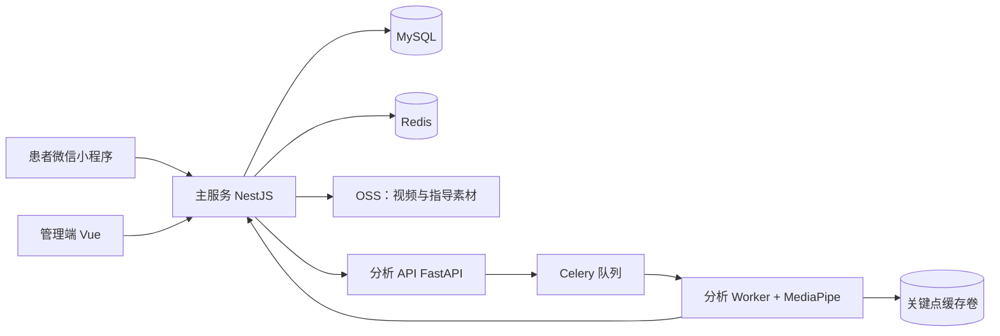

# 安舒随行项目交接与运行指南

> 更新日期：2026-10-23
>
> 适用对象：接手开发、测试与日常运维的同学。
> 本文是**交接摘要和运行索引**，不替代架构、算法或部署手册。涉及当前产品事实时，以代码、数据库、运行时有效环境变量与下列规范文档为准。

## 1. 接手时先建立的认识

安舒随行是一个居家动作训练与记录工具：患者通过微信小程序查看指导内容、上传短视频或创建自主记录；系统异步分析视频、生成本次反馈与训练留痕；管理端维护患者、指导内容、配置和反馈。

当前支持的动作与产品边界：

| 动作 | 主要观察内容 | 视频硬上限 | 不能被解释为 |
| --- | --- | --- | --- |
| 缩腹运动 `abdominal_crunch` | 腹部/躯干运动代理、完整动作和节奏 | 30 秒 | 医疗诊断或康复疗效 |
| 骨盆倾斜 `pelvic_tilt` | 后倾—回中立的可见闭环 | 30 秒 | 精确临床测量 |
| 膝关节旋转 `knee_rotation` | 双膝双向运动和左右控制 | 60 秒 | 关节活动度或治疗评级 |

视频用于动作观察、生成建议和训练留痕，**不要求完整训练过程**。分析质量不足、待复核或失败，不等同于用户“做错了”或“没有训练”。

## 2. 先读什么、到哪里改

| 问题 | 规范来源 | 代码入口 |
| --- | --- | --- |
| 产品能力、患者状态与文案、激励 | [产品视角：产品能力与用户旅程](项目梳理/产品视角_产品能力与用户旅程.md) | `apps/patient-miniapp`、`services/main-service/src/motivation` |
| 服务边界、接口流、数据模型 | [开发者视角：系统架构与实现地图](项目梳理/开发者视角_系统架构与实现地图.md) | `apps/`、`services/`、`packages/` |
| 当前功能和运行口径 | [当前实现口径](技术方案/当前实现口径.md) | 主服务、分析服务、实际有效环境变量 |
| 三个动作的切分、评分与版本边界 | [三类康复动作拆分、分析与评分说明](技术方案/三类康复动作拆分分析评分说明.md) | `services/analysis-service/app` |
| 本地启动、端口和常见问题 | [本地启动运行指南](本地启动运行指南.md) | `start-local.sh`、根目录 `.env` |
| 单机发布、回滚和 Nginx | [阿里云 ECS 发布部署操作手册](阿里云ECS发布部署操作手册.md) | `infra/docker-compose.production.yml`、`deploy-production.sh` |
| 事故证据和复盘 | [`operations/`](operations/) | 对应日期记录 |
| 全部文档的职责与状态 | [文档导航](README.md) | `docs/README.md` |

**原则：**交接文档只记录“下一步如何判断和处理”；不要把架构图、算法公式或完整部署步骤复制到这里。修改一项规则时，先找到上表中的唯一规范来源，再同步代码和必要的患者可见文案。

## 3. 系统在一张图里



- `apps/patient-miniapp`：患者端的训练、上传、报告、历史、自主记录、反馈。
- `apps/admin-web`：患者、指导内容、拍摄要求、评分模板、患者配置、激励规则与反馈处理。
- `services/main-service`：登录、内容版本/启用、上传签名、任务协调、报告、训练记录、激励与系统配置。
- `services/analysis-service`：抽帧、姿态/视觉分析、切分、评分和异步回调。
- `packages/shared-contract`：跨端接口契约；改接口前先检查这里。

## 4. 已交付能力：按“可用边界”交接

这一节不罗列页面细节，而是说明接手后可以依赖什么、改动时要保护什么。

| 能力域 | 已落地能力 | 改动时必须守住的边界 |
| --- | --- | --- |
| 指导内容 | 管理端维护基础信息、教学视频、步骤、拍摄要求、常见错误；患者端按内容版本展示 | 保存会生成内容版本；“保存”不等于患者端可见，仍由启用/下线控制；必填校验与患者端展示顺序见当前实现口径 |
| 视频训练 | 拍摄/相册上传、异步分析、报告、历史记录和关键点预览 | 短视频上限为动作硬约束；确认上传先形成训练留痕，分析结果随后回调；不要把排队、质量不足或待复核当作失败 |
| 自主记录 | 管理端开关控制、患者端创建/查看 | 每位患者每天最多一条；已有记录始终可查看 |
| 三类动作分析 | 缩腹视觉完整周期、骨盆姿态闭环、膝关节双膝双向规则路径均已接入 | 新旧分析结果不能脱离 `analysis_version`、模板/切分版本和运行开关横向比较 |
| 激励与长期反馈 | 训练日、连续天数、阶段、徽章、同动作趋势和 6 个进步阈值 | 训练日来自确认上传/自主记录，不等于高分；短视频和质量不通过结果有专门的排除规则 |
| 反馈与安全分流 | 患者反馈、工单状态、身体不适类反馈的安全提示与自动关闭语义 | 不把一般产品问题当成医疗建议；具体类型与状态见[训练反馈工单](反馈规划.md) |

## 5. 容易踩坑的“当前事实”

### 5.1 内容、训练和状态

- 指导内容编辑页没有可见“草稿”流程，但底层 `draft_snapshot` 为历史数据兼容保留；不要据此恢复双草稿流程。
- 上传确认成功后会有训练留痕；`queued`/`processing` 在单 Worker 下是正常状态，不承诺固定完成时间。
- `quality_insufficient`、`review_required`、`failed` 的患者文案应给出原因与下一步，不能归因成“动作不合格”。
- 自主记录、视频训练、趋势和徽章的互相影响有边界；改激励前先阅读当前实现口径第 4 节并补对应用例。

### 5.2 分析口径与环境变量

缩腹、骨盆、膝关节不共享一套固定模板评分流程。运行开关会改变**新视频**的路径；历史结果以当时保存的版本和快照解释，不会自动重算。

| 必须核对的变量 | 作用 | 交接要求 |
| --- | --- | --- |
| `ABDOMINAL_SEGMENTATION_MODE` | 缩腹是否进入视觉完整周期路径 | 发布后在 Worker 容器中核对有效值 |
| `ABDOMINAL_VISUAL_SCORE_MODE` | 缩腹视觉规则分口径 | `evidence` 与 `legacy` 不是普通性能开关，改动需要产品/算法共同验收 |
| `KNEE_ROTATION_MODE` | 膝关节双膝路径或历史回退路径 | 不要混合不同路径做趋势比较 |
| `SAMPLE_FPS`、`MODEL_COMPLEXITY`、帧数/宽度上限 | 分析耗时、资源占用与证据密度 | 小规格机器上先评估资源与样本，再调整 |

根目录 `.env.example`、代码默认值和 `infra/docker-compose.production.yml` 的缺省值并非完全一致，特别是缩腹视觉评分模式。**任何发布验收都必须记录 analysis-worker 的实际有效环境变量，不能只看 Compose 文件。**

## 6. 开发与验证交接

### 6.1 本地工作流

优先按[本地启动运行指南](本地启动运行指南.md)操作。全栈启动脚本为：

```bash
./start-local.sh
```

脚本会检查 Node 20、MySQL、Redis，执行 Prisma 迁移/生成，并启动主服务、分析 API、Worker、Beat 和管理端。常用静态检查：

```bash
npm run typecheck
npm run build -w @home-rehab-motion/main-service
npm run build -w @home-rehab-motion/admin-web
git diff --check
```

分析服务的测试位于 `services/analysis-service/tests/`；主服务的契约测试位于 `services/main-service/tests/`。CI 当前会执行 TypeScript 检查、主服务/管理端构建、分析服务编译检查、生产 Compose 插值检查和三个镜像构建；它**不会**代替真实视频分析、小程序端到端和线上有效配置核验。

> 注意：本地分析 API 统一默认使用 `8000`。如需覆盖端口，必须在 `.env` 中同时修改 `ANALYSIS_PORT` 与 `ANALYSIS_SERVICE_URL`；本地联调以该文件的实际值为准。

### 6.2 改动后的最小验收集

| 改动类型 | 最少要验证 |
| --- | --- |
| 小程序页面/文案 | 微信开发者工具：登录 → 指导 → 上传/自主记录 → 状态页 → 报告/历史；核对异常状态文案 |
| 指导内容与管理端 | 保存缺项提示、启用/下线、患者端实际展示顺序；不要只看管理端预览 |
| 主服务接口/数据模型 | 类型检查、构建、对应契约测试、迁移前备份与回滚方案 |
| 分析、切分或评分 | 对应 Python 测试 + 三类动作各至少一段代表样本；记录版本、有效开关、期望路径和结果 |
| 激励/趋势 | 同日多次训练、短视频、质量不足、待复核、跨版本结果和自主记录的回归用例 |
| 生产发布 | CI 绿灯、容器状态、两个健康检查、管理端 HTTP、一次真实“上传 → 分析 → 报告” |

## 7. 生产运行交接（截至 2026-10-23 的快照）

以下是已核查过的**历史运行快照**，不是永久承诺；后续接手人应在每次发布/迁移后重新记录日期、镜像 Tag、健康检查和实际环境变量。

| 项目 | 最近已核查状态 |
| --- | --- |
| 生产版本 | `v0.1.36`；2026-10-23 已核验三个业务镜像、主服务存活/就绪接口与管理端 HTTP 200 |
| 入口 | `https://admin.bjrpxx.cn/rehab/`（管理端）、`https://admin.bjrpxx.cn/api/`（API） |
| 主机与目录 | ECS `101.200.164.177`，`/opt/home-rehab-motion` |
| 资源约束 | 约 1.6 GiB 内存 + 1 GiB Swap；分析 Worker 保持 `--concurrency=1` |
| 公网暴露 | 宝塔/Nginx 提供 80/443；Docker 服务和数据库仅本机/内网访问 |

### 发布、回滚与配置变更的底线

1. 三个业务镜像使用同一不可变 Tag，先确认 CI 与镜像推送成功，禁止用 `latest`。
2. 有 Prisma migration 时，先备份 MySQL；镜像回滚不会自动回滚数据库。
3. 环境变量变更后重建至少 `analysis-service` 与 `analysis-worker`；`docker restart` 不会重新载入环境变量。
4. 发布后至少执行：容器 `ps`、`/api/health/live`、`/api/health/ready`、`/rehab/` HTTP，以及一条真实视频链路。
5. 发生异常先保留日志、有效环境变量和资源快照，再决定回滚或扩容；不要在没有证据时增加 Worker 并发或资源限制。

完整命令、Nginx 配置、备份和回滚步骤请使用[阿里云 ECS 发布部署操作手册](阿里云ECS发布部署操作手册.md)，不要根据本摘要补写部署命令。

### 运行资产与资源风险

- `analysis-keypoints-data` 是关键点 JSON 缓存卷：删掉不会删除 OSS 原视频和 MySQL 报告，但会失去缓存，需要后续重新解码/生成预览。除非明确接受性能损失，**不要删除该卷**。
- 2026-10-21 的 CPU 高峰已归因于 HBR 根目录扫描，尾段叠加系统维护，并非 Worker 持续运行。再次发生时先保留资源采样、Worker 日志和系统/HBR 日志，详见[CPU 事件记录](operations/2026-10-21-cpu-incident.md)。
- 教学/算法验证视频需要保留，但不应随代码仓库提交或随文档清理删除；规则见[视频资产说明](视频资产说明.md)。

## 8. 值班排障顺序

| 现象 | 先查什么 | 不要直接做什么 |
| --- | --- | --- |
| 管理端 502/打不开 | `admin-web` 容器、`127.0.0.1:8080`、Nginx 根路径反代和证书 | 暴露 8080 到公网 |
| API 404 | `/api/` 的 Nginx `proxy_pass` 是否错误带尾部 `/`，再查主服务日志 | 盲目重建所有容器 |
| 上传失败 | 微信合法域名、OSS CORS/白名单、签名 URL、主服务日志 | 恢复已废弃域名 |
| 长期“分析中” | Worker/Redis/队列、回调和 Worker 日志；确认是否只是单并发排队 | 直接调大 Worker 并发 |
| 分析失败或主机卡顿 | 资源快照、视频时长/分辨率、Worker 内存、MediaPipe 日志 | 在证据不足时扩 CPU/内存 |
| 骨架预览缺失 | 缓存卷挂载、分析采样帧与源视频帧的映射 | 删除缓存卷“修复” |
| 磁盘持续增长 | `docker system df`、缓存卷、宝塔日志、HBR、临时文件 | 未确认目标就清理 Docker 卷/镜像 |

## 9. 待办、风险与建议优先级

| 优先级 | 建议 | 完成标准 |
| --- | --- | --- |
| P0 | 固化发布后的有效配置核验 | 发布记录包含镜像 Tag、Worker 的三项分析开关、健康检查与一条真实视频结果 |
| P1 | 把三类动作样本验收做成可重复清单 | 每个样本有来源/脱敏状态、预期路径、版本、结果截图或结构化断言 |
| P1 | 补小程序端到端验收 | 覆盖上传、排队、质量不足、待复核、报告、历史、自主记录及患者文案 |
| P1 | 统一本地分析端口说明 | `start-local.sh`、`.env.example`、本地指南和开发者文档使用同一默认值或明确覆盖关系 |
| P2 | 清理历史未发布内容快照 | 先备份并提供可回滚的一次性迁移；不得直接删库数据 |
| P2 | 评估分析服务拆机 | 以分析量、内存/Swap、排队时长和错误率为证据；优先独立 Worker 主机，不在小机盲目并发 |

## 10. 交接完成标准

接手人不需要记住所有页面和算法细节，但应能在半小时内完成以下事情：

1. 通过第 2 节找到一个需求对应的规范文档和代码入口；
2. 在本地启动服务并完成一条最小训练链路；
3. 说明三种动作的分析路径为何不能混合比较；
4. 发布后核对容器、健康检查、有效环境变量与真实视频结果；
5. 在“分析中”、上传失败、资源异常三类问题中，先保留什么证据、再查什么服务。

达到以上标准后，再进入页面优化、算法调参或基础设施变更；这样能避免把历史文档、Compose 缺省值或单次结果误当作当前生产事实。
