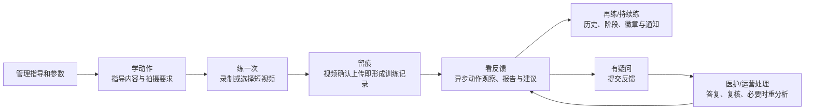
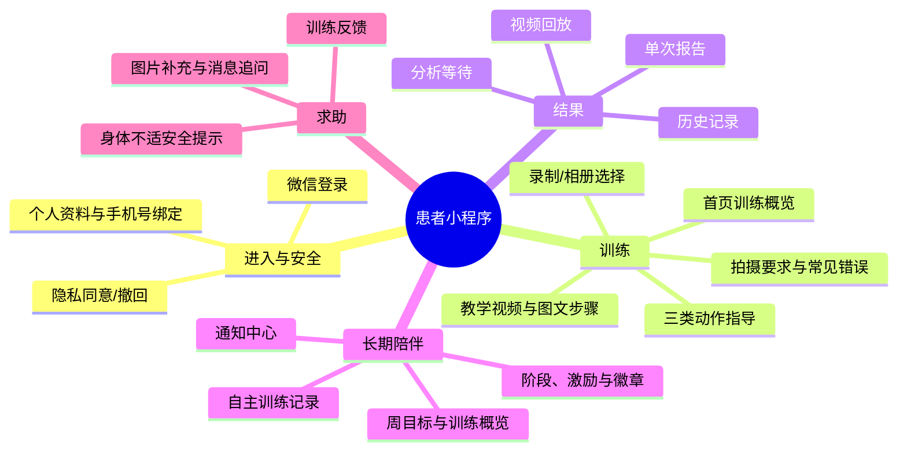
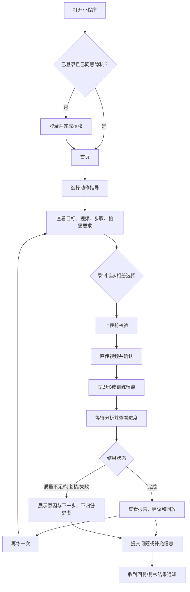
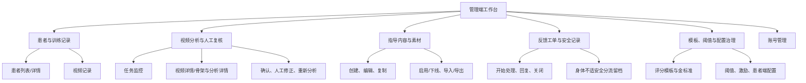
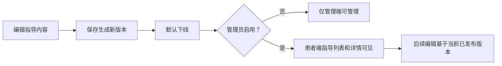
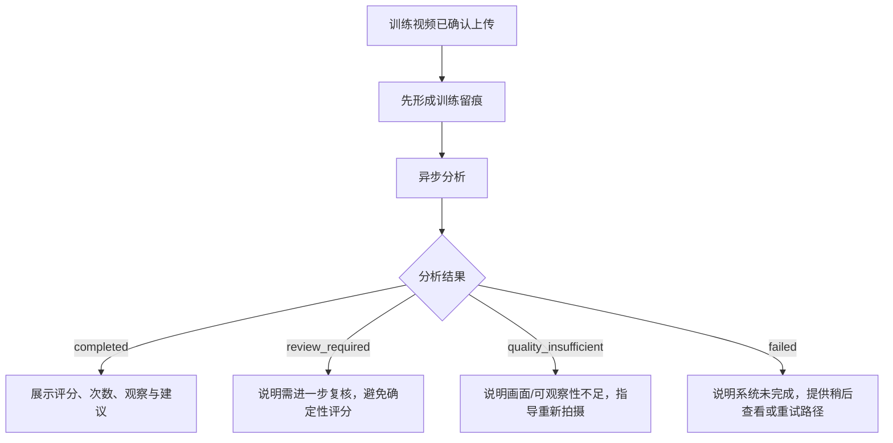

# 安舒随行：产品视角的能力全景与用户旅程

> 现状基线：2026-10-23。本文面向产品、运营、医护协作与验收人员，描述当前已实现能力和明确边界；不将历史规划当作已上线功能。

## 1. 产品一句话

**安舒随行**帮助居家康复训练者“看懂怎么练、留下练习片段、获得本次训练反馈、持续记录进步”，同时让医护/运营人员能够管理指导内容、观察训练记录、处理疑问并对异常结果进行人工复核。

它是训练辅助与记录工具，不替代医生诊断、治疗方案或临床测量。

## 2. 用户、价值与使用端

| 用户 | 使用端 | 获得的价值 |
| --- | --- | --- |
| 患者/训练者 | 微信小程序 | 看动作指导、按要求拍摄短片段、查看训练反馈和历史、获得持续练习激励 |
| 医护人员 | 管理端 Web | 查看患者和训练记录、理解分析信息、人工复核、回复患者问题 |
| 运营/内容人员 | 管理端 Web | 配置和发布动作指导、维护素材和患者端限制、观察反馈闭环 |
| 管理员 | 管理端 Web | 管理账号、评分模板/阈值、激励规则、流程验证和治理能力 |

## 3. 产品闭环图

产品闭环的关键不是“给视频打一个分”，而是把一次训练连接成可理解、可回看、可沟通、可持续的体验。

## 4. 患者端功能地图

### 4.1 当前患者端主要页面

| 页面 | 用户要完成的事 | 当前能力 |
| --- | --- | --- |
| 登录 | 建立安全的使用身份 | 微信登录、隐私协议确认、手机号授权登录能力 |
| 首页 | 知道今天做什么、最近练得怎样 | 今日入口、周训练、旅程阶段、最近记录、通知提醒 |
| 训练指导列表/详情 | 学会并按要求练动作 | 动作概览、训练建议、安全提示、教学视频、步骤、拍摄要求、常见错误 |
| 上传确认 | 留下一段合格的训练片段 | 录制或从相册选择、格式/时长/大小校验、直传上传 |
| 分析等待 | 知道系统正在做什么 | 排队/质检/分析/报告等过程状态、超时后的历史入口 |
| 训练报告 | 了解本次训练的可观察结果 | 有效次数、表现维度、建议、回放、徽章/激励、反馈入口 |
| 历史记录 | 回顾既往练习 | 按状态查看记录、进入报告/等待页、对失败结果获取下一步指引 |
| 自主训练 | 补充非视频训练的日常留痕 | 受管理端开关控制，每天最多一条，既有记录可查看 |
| 我的 | 管理个人信息与权益 | 资料、训练概览、徽章墙、隐私授权、退出 |
| 通知/反馈 | 接收结果、提出问题 | 分析完成和工单回复通知；文字/图片反馈与时间线追问 |

## 5. 患者训练旅程

### 5.1 患者能得到什么反馈

| 反馈层次 | 面向患者的表达 |
| --- | --- |
| 本次表现 | 本段练习的有效次数、综合表现和动作观察 |
| 可执行建议 | 哪个环节可再注意、下一次如何拍得更清楚或练得更完整 |
| 回看依据 | 与本次记录关联的视频回放 |
| 长期坚持 | 累计训练、周期/阶段、徽章和通知 |
| 人工支持 | 对报告、动作、上传等问题提交反馈，查看工作人员回复 |

### 5.2 三类可训练动作

| 动作 | 产品上希望观察的完成情况 | 拍摄/使用提醒 |
| --- | --- | --- |
| 缩腹运动 | 是否完成可见的收紧/躯干收缩、节奏与保持 | 建议侧方或略侧方，让肩髋及身体变化可见 |
| 骨盆倾斜 | 是否完成“后倾到顶点再回中立”的完整闭环 | 建议正侧方拍摄，清楚呈现腰背/骨盆前后变化 |
| 膝关节旋转 | 是否完成左右双向旋转并回正、左右控制是否均衡 | 建议正面或略高机位，完整拍到双髋、双膝、双踝 |

## 6. 管理端功能地图

| 工作域 | 当前可做的事 | 对患者的影响 |
| --- | --- | --- |
| 工作台/患者管理 | 查看患者列表、详情、训练上下文 | 支持有上下文地跟进训练者 |
| 视频和分析任务 | 查看状态、质量、特征、骨架回放、任务进度 | 定位分析异常和训练记录问题 |
| 人工复核 | 确认算法结果、人工修正评分/问题/建议、重新分析 | 患者端可优先使用人工修正后的结果 |
| 指导内容 | 新建、编辑、复制、上传素材、启用/下线、导入/导出 | 决定患者可看见什么动作指导和拍摄要求 |
| 反馈工单 | 查看、开始处理、模板/人工回复、关闭、批量关闭 | 患者能收到答复并继续追问 |
| 安全分流 | 查看身体不适相关的留档 | 此类反馈自动给出安全提示，不进入普通人工待办 |
| 配置治理 | 管理模板版本、金标准提取、阈值、激励规则、患者端限制 | 影响后续训练的分析/激励和使用限制，不改写历史报告 |
| 账号管理 | 管理管理员/医护账号状态与密码 | 保障管理端访问可控 |

## 7. 内容发布与患者可见规则

一条可用的动作指导至少覆盖：动作类型、标题、一句话目标、训练建议、封面图、训练前安全提示、教学视频、3–5 个动作步骤、至少一条带示意图的拍摄要求。常见错误可以选填，但填写时必须同时有错误说明、正确做法和示意图。

患者端详情的阅读顺序固定为：**动作概览 → 训练建议 → 安全提示 → 教学视频 → 动作步骤 → 拍摄要求 → 常见错误 → 拍摄/相册入口**。

## 8. 分析结果的产品解释原则

产品验收时需要坚持：

- 视频确认上传后即是训练记录；分析结果稍后生成。
- `quality_insufficient`、`review_required`、`failed` 不能被翻译成“你练错了”。
- 单次报告反映本段视频；长期阶段来自累计训练和训练周期，不能由一次分数直接升降。
- 模板、阈值、激励规则的变更只作用于之后的训练；历史报告仍以当时的快照解释。

### 8.1 已实现的状态—产品话术矩阵

这张表是当前小程序和服务端实际话术的归纳，可作为产品验收与文案调整的共同基线。规则、阈值和数据条件仍以[当前实现口径](../技术方案/当前实现口径.md)为准。

| 场景/状态 | 当前患者表达的核心意思 | 可执行下一步 | 产品边界 |
| --- | --- | --- | --- |
| 上传确认中 | “正在确认您的视频”，核对文件并创建任务 | 等待确认 | 不承诺已开始分析 |
| 排队/等待资源 | “视频已收到，系统即将开始处理” | 等待或稍后到历史查看 | 视频已留痕，不要求重复上传 |
| 质量检查/姿态提取/动作分析/生成报告 | 分别说明正在检查画面、识别姿态、分析动作、整理报告 | 等待 | 过程文案不把分析说成诊断 |
| 正常完成 | “本次训练分析完成”，进入报告 | 查看本段观察、建议、回放 | 单次结果只针对本段视频 |
| 缩腹视觉证据分可用 | “本次练习已记录”“按舒适幅度继续保持练习” | 查看完整动作次数、阶段时长与本段规则分 | 规则分未做临床结局校准，不推断康复进步 |
| 缩腹视觉不可观察/未评分 | “本次训练已记录”，画面暂不足以可靠观察完整周期 | 下次拍全开始准备和最后放松 | 未评分不是 0 分、不是未练习 |
| 待人工复核 | “训练已记录，观察待复核”；复核前不展示分数和动作判断 | 按动作指导练习、稍后查看 | 不要求为了得分勉强增大幅度 |
| 视频质量不足：文件不完整 | “视频文件未完整上传” | 检查网络，重新选择原视频 | 保留训练记录；不归咎动作 |
| 视频质量不足：画面/关键点不稳 | “拍摄画面暂不适合评估” | 查看拍摄要求，改善取景、光线、遮挡后决定是否重拍 | 不将不可观察等同于动作错误 |
| 分析服务繁忙/超时 | “训练记录已保留，暂时没有生成动作观察” | 稍后从历史查看，不需立即重传 | 区分系统问题和拍摄问题 |
| 其他分析失败 | “视频已经保存，但本次动作观察没有完成” | 稍后查看，必要时重传 | 训练留痕仍有效 |
| 身体不适反馈 | 暂停训练，并以医生或医疗机构建议为准 | 查看安全提示、寻求医疗建议 | 不同时展示与“暂停训练”冲突的动作建议 |

### 8.2 已实现的激励与趋势表达

| 类型 | 触发条件 | 当前表达/呈现 | 不应被解读为 |
| --- | --- | --- | --- |
| 训练日 | 确认上传视频；同日只计 1 天 | 周目标、连续天数、训练日历 | 视频分析通过或临床改善 |
| 长期旅程 | 训练次数与训练周数共同满足门槛 | 纠正期 → 巩固期 → 激励期 | 由一次得分升降的能力评级 |
| 徽章 | 首次训练、连续 3/7 天、累计 30/60/90 天；非短片段首次优秀 | 例如“迈出第一步”“稳定练习很了不起” | 医疗效果认证 |
| 同动作进步 | 可比较记录的保持时长、稳定性或综合分达到轻微/明显阈值 | “保持时间更长”“身体更稳”“综合表现进步明显” | 视觉缩腹短片段的康复进步结论 |
| 无可比记录 | 首次、版本不同、质量/置信度不够、人工覆盖或视觉缩腹证据分 | “本段观察已记录，暂无可靠的同版本视频可供比较” | 没有训练价值 |

这部分已具备落地条件：前端已有状态页、报告页和历史入口，后端已输出状态、报告重点、激励摘要和徽章。但若要统一改文案，应把上表作为产品验收资产，集中在本文维护；服务端文案仍分布于报告、分析等待和失败映射中，改动需要三处同步验证。

## 9. 关键规则与当前范围

| 主题 | 当前规则 |
| --- | --- |
| 视频片段 | 患者不需要上传完整训练过程，只上传用于观察的一段片段 |
| 时长上限 | 缩腹、骨盆倾斜最多 30 秒；膝关节旋转最多 60 秒；还受患者端动态配置限制 |
| 自主训练 | 可由管理端开关控制；开启时每人每天最多创建一条 |
| 报告评分 | 展示动作观察、有效次数、建议等；不作为临床诊断 |
| 阶段与激励 | 阶段由累计训练/训练周期决定；激励规则基于后续结果计算 |
| 内容启用 | 已保存不等于患者可见，只有“启用”的内容会出现在患者端 |
| 人工复核 | 人工结论可覆盖患者端应优先展示的算法结果，原算法结果仍保留 |
| 隐私 | 视频分析须有授权；敏感访问有审计留痕 |

## 10. 产品验收建议：按闭环而不是孤立页面验收

| 验收闭环 | 核验重点 |
| --- | --- |
| 指导发布闭环 | 编辑必填校验 → 保存新版本 → 启用 → 患者端按既定顺序看到内容 → 下线后不再展示 |
| 视频训练闭环 | 合法片段校验 → 上传确认形成记录 → 等待页状态 → 报告/异常状态 → 历史可追溯 |
| 结果解释闭环 | 正常、质量不足、待复核、失败各有符合边界的表达和下一步，避免责备性文案 |
| 人工支持闭环 | 患者提交反馈 → 管理端处理/回复 → 患者收到通知并能回到相关记录 |
| 人工复核闭环 | 管理端查看分析上下文 → 录入结论或重分析 → 患者侧展示使用正确的优先结果 |
| 配置治理闭环 | 修改模板/阈值/激励/患者端限制后影响新结果；旧报告不被追溯篡改 |

## 11. 面向产品协作的待关注点

- **动作范围有限**：当前仅支持三类动作；扩展新动作不是仅增加一张指导页，还需新增拍摄规范、分析信号、周期语义、模板、报告表达、测试和配置。
- **分析是异步能力**：界面和运营 SOP 要接受“训练留痕先形成、结果后生成”的节奏，并覆盖失败和复核分支。
- **拍摄指导是结果质量的一部分**：机位、入镜完整度和光线直接决定视频是否可观察，不能把它当作装饰性内容。
- **医疗安全表达要保守**：系统给出训练观察与建议，不对病情、疗效或诊疗方案做确定性宣称；身体不适必须走安全提示与留档。
- **配置变更有历史边界**：模板/阈值/激励的版本治理和结果快照是解释一致性的基础，产品变更要显式定义生效时间。

## 12. 相关材料

- [开发者视角：系统架构与实现地图](开发者视角_系统架构与实现地图.md)
- [当前实现口径](../技术方案/当前实现口径.md)
- [三类康复动作拆分分析评分说明](../技术方案/三类康复动作拆分分析评分说明.md)
- [反馈规划](../反馈规划.md)

