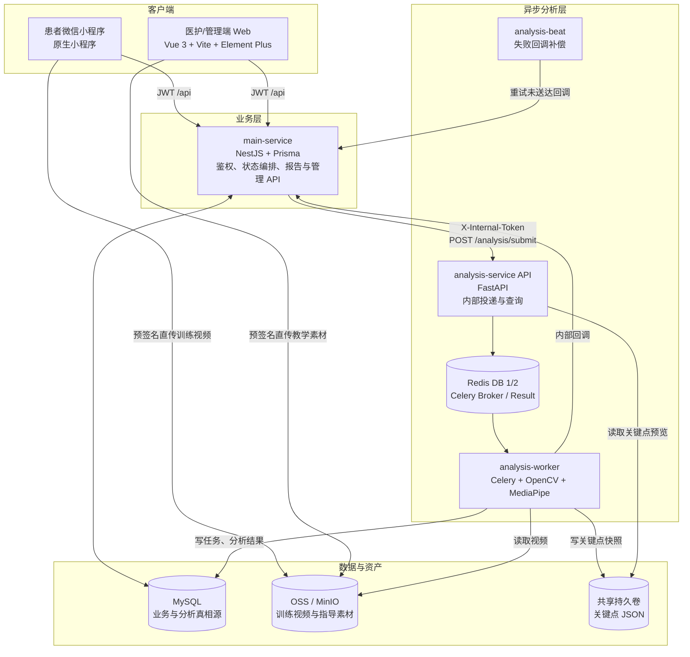
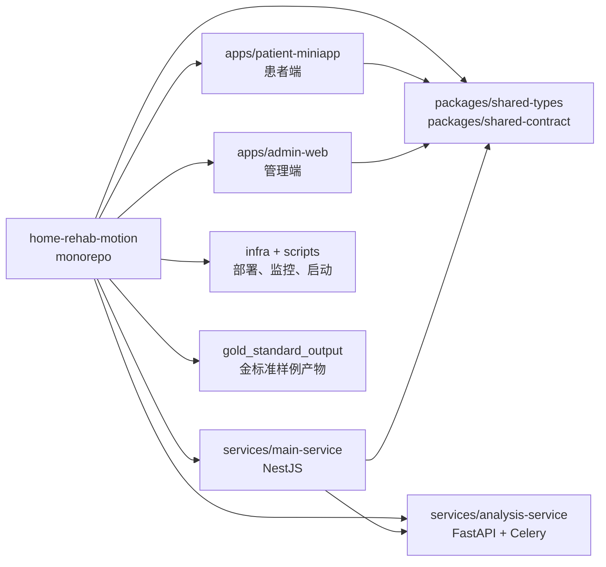
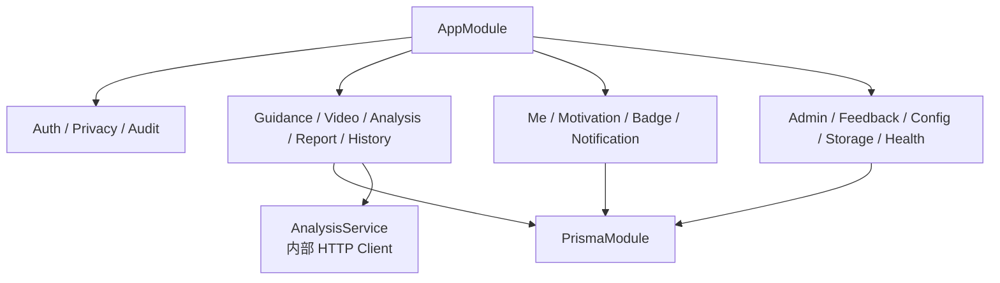
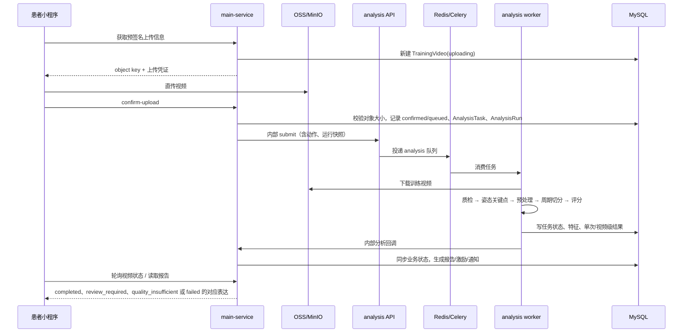
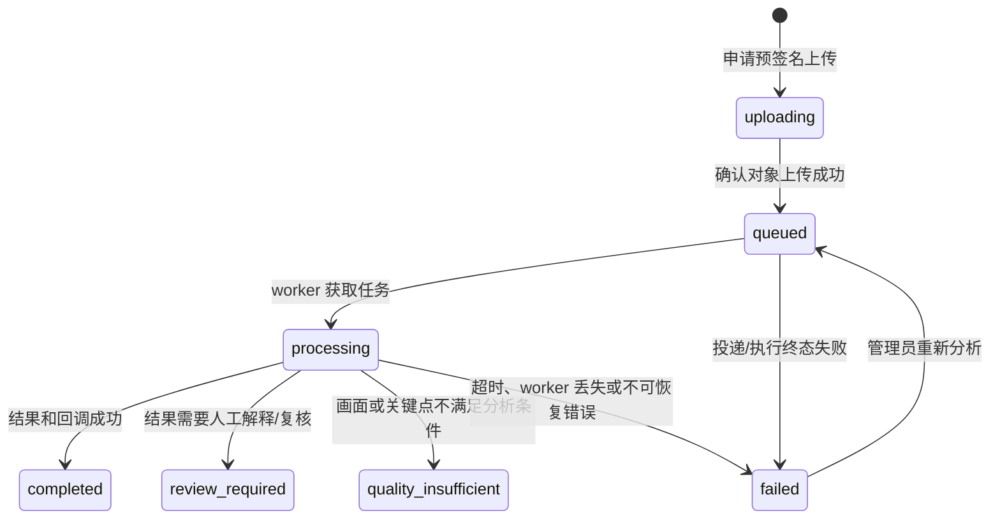
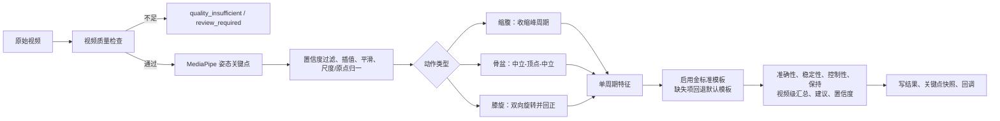
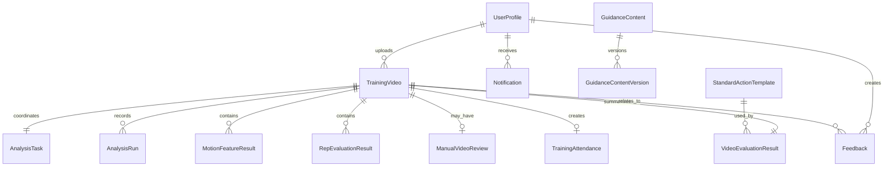

# Home Rehab Motion：开发者视角的系统架构与实现地图

> 代码基线：2026-10-23 工作区现状。本文以实际代码、数据库模型、部署编排和现行口径为准；`docs/archive/` 中的方案只用于追溯，不代表当前功能。

## 1. 系统定位与边界

Home Rehab Motion（患者端品牌名：**安舒随行**）是一个居家康复训练的数字化闭环系统：患者学习动作、上传一段训练片段；系统异步观察动作完成情况并产出训练反馈；医护/运营人员维护指导内容、复核分析结果、处理反馈并治理算法模板与配置。

当前支持的动作只有三类：

| 代码 | 患者侧名称 | 当前观察重点 |
| --- | --- | --- |
| `abdominal_crunch` | 缩腹运动 | 躯干/腹部收缩代理、节奏、完整周期 |
| `pelvic_tilt` | 骨盆倾斜 | 后倾—回中立闭环、稳定性、保持 |
| `knee_rotation` | 膝关节旋转 | 双向旋转、左右控制、回正 |

**关键边界**：视频分析是动作观察、训练反馈与留痕激励能力；它不输出医疗诊断、治疗方案或精确临床测量结论。分析异常、质量不足和待人工复核都不能直接解释为“患者做错”。

## 2. 运行时架构

### 2.1 真相源与职责边界

| 组件 | 最终负责什么 | 不应承担什么 |
| --- | --- | --- |
| `main-service` | 用户/管理员身份、上传确认、业务状态、报告聚合、人工复核、通知、训练激励、内容和配置管理 | MediaPipe 推理和视频逐帧计算 |
| `analysis-service API` | 内部鉴权、Celery 任务投递、内部任务/关键点查询 | 面向公网的患者业务 API |
| `analysis-worker` | 下载、质检、姿态提取、预处理、周期切分、特征/评分、回调 | 业务文案、页面流程、用户通知 |
| MySQL | 业务状态、分析任务/运行快照、评分结果、审计和配置的最终记录 | 大型媒体文件 |
| OSS/MinIO | 视频、封面/教学/反馈图片等二进制资产 | 业务查询与状态机 |
| Redis | Celery 队列和结果后端 | 业务状态最终真相源 |
| 关键点持久卷 | 骨架回放和分析诊断的 JSON 快照 | 报告聚合真相源 |

## 3. 仓库结构与依赖关系

| 路径 | 主要内容 | 阅读/修改时的注意点 |
| --- | --- | --- |
| `apps/patient-miniapp` | 登录、指导、上传、等待、报告、历史、自主训练、反馈、隐私、通知、我的 | 通过 `services/*.js` 调用主服务；上传是直传对象存储，不经业务服务转发文件 |
| `apps/admin-web` | 工作台、患者/视频/任务、复核、指导、反馈、模板/阈值/配置、账号 | 路由集中在 `src/router/index.ts`，权限由路由守卫和后端双重保障 |
| `services/main-service/src` | Nest 模块化业务实现 | 控制器是 API 边界；服务层编排状态和 Prisma 数据写入 |
| `services/main-service/prisma/schema.prisma` | 业务数据模型与关系 | Schema 与 migrations 必须同步审查；历史结果依赖版本/快照字段保持可追溯 |
| `services/analysis-service/app` | FastAPI、Celery、算法核心、分析库 | 三个动作的算法入口与共享预处理均在 `core/`；worker 是实际执行者 |
| `infra/` | local/production Compose、资源监控单元 | 生产约束是单机低资源部署，不能忽略内存/CPU 限制 |
| `docs/技术方案/` | 当前口径、算法说明、上线与运行指南 | 优先读 `当前实现口径.md` 与三类动作说明；归档文件不可当成现状 |

## 4. 主服务模块地图

| 领域 | 主要模块 | 关键职责 |
| --- | --- | --- |
| 身份与合规 | `auth`、`privacy`、`audit` | 微信/模拟登录、管理员登录、隐私同意和撤回、敏感访问审计 |
| 训练主链路 | `guidance`、`video`、`analysis`、`report`、`history` | 发布指导、预签名上传、确认上传、投递分析、接收回调、报告/历史查询 |
| 激励与个人中心 | `me`、`motivation`、`badge`、`notification` | 周期训练概览、自主记录、阶段/激励、徽章、通知、个人资料 |
| 医护运营 | `admin`、`feedback`、`config`、`storage` | 患者/账号、视频复核、工单、模板/阈值/患者端配置、对象存储 |
| 平台能力 | `prisma`、`health`、`common/runtime` | 数据访问、健康检查、环境配置、统一响应和异常过滤 |

## 5. 核心业务链路：视频上传到患者报告

### 5.1 状态与可靠性设计

- `TrainingVideo` 保存面向业务的状态；`AnalysisTask` 保存任务、阶段、回调重试；`AnalysisRun` 固化某次运行的算法、模板、阈值等快照。
- 分析投递幂等：worker 正在处理或已有 provider task ID 的排队任务会去重；管理端重新分析会创建新的运行语义，不能被旧队列状态误挡住。
- Worker 使用 `acks_late`、重试与 worker-lost 终态回写，避免原生算法进程异常后无限重投或患者一直停在处理中。
- 回调失败由 `analysis-beat` 定时补偿；主服务不将短暂分析服务不可用伪装为已完成。

## 6. 算法处理流水线

| 动作 | 主信号 | 合格 Rep 的业务语义 | 代表性特征 |
| --- | --- | --- | --- |
| 缩腹 | 小程序短片段在 `shadow` 模式下优先使用腹壁视觉信号；其他模式回退肩—髋姿态信号 | 视觉路径要求完整收缩—保持—回位；姿态路径为独立收缩及其过渡 | 视觉规则分或姿态特征分，取决于运行快照 |
| 骨盆倾斜 | 肩—髋有符号矢状面倾角 | 稳定中立 → 后倾顶点 → 回稳定中立 | 后倾摆幅、骨盆偏移、顶点晃动、保持 |
| 膝关节旋转 | `bilateral` 模式使用双膝相对位移；回退模式使用历史姿态信号 | 两个相反方向的转动都发生且分别回正 | 双膝激励型规则分，或历史姿态模板分 |

实现约束：低置信度关键点不可直接驱动判定；短缺失才插值；动作与模板不兼容时不能输出貌似精确的数值评分；患者短片段与管理端流程验证有不同的时长和诊断边界。运行时必须记录缩腹和膝关节的模式开关；生产 Compose 的缩腹视觉评分缺省值仍为 `legacy`，而代码默认值和 `.env.example` 为 `evidence`，不能将其视为同一事实。

## 7. 核心数据模型

重点表及其用途：

| 数据对象 | 用途 |
| --- | --- |
| `TrainingVideo` | 一次上传视频的业务载体：动作、对象键、时长、分析/质量状态、模型版本 |
| `AnalysisTask` / `AnalysisRun` | 队列任务和一次运行的生命周期、阶段、回调、重试、版本化快照 |
| `MotionFeatureResult` / `RepEvaluationResult` / `VideoEvaluationResult` | 特征、逐周期评分、视频汇总报告三层结果 |
| `ManualVideoReview` | 人工结论和人工结果覆盖开关，保留算法原始结果作追溯 |
| `GuidanceContent` / `GuidanceContentVersion` | 患者可见指导内容及其历史版本 |
| `StandardActionTemplate` | 动作评分的金标准/派生模板、启用状态、血缘和变更摘要 |
| `Feedback`、`FeedbackMessage`、`FeedbackStatusLog` | 患者反馈、对话、流转留痕；身体不适走安全分流 |
| `PatientPrivacyConsent` / `SensitiveAccessAudit` | 视频分析授权和敏感数据访问记录 |

## 8. 前后端功能映射

| 使用面 | 关键功能 | 后端领域 |
| --- | --- | --- |
| 患者端 | 登录、隐私、首页与训练概览 | `auth`、`privacy`、`me` |
| 患者端 | 指导内容、拍摄要求、训练入口 | `guidance`、`config` |
| 患者端 | 预签名上传、分析等待、报告、历史 | `video`、`analysis`、`report`、`history`、`storage` |
| 患者端 | 自主训练、徽章、通知、反馈 | `me`、`motivation`、`badge`、`notification`、`feedback` |
| 管理端 | 工作台、患者/视频/任务查看、人工复核、重分析 | `admin`、`video`、`report` |
| 管理端 | 指导内容及素材管理 | `guidance`、`storage` |
| 管理端 | 模板、阈值、激励、患者端配置 | `config`、`motivation` |
| 管理端 | 工单与安全记录、账号管理 | `feedback`、`admin`、`audit` |

## 9. 部署、监控与测试

### 9.1 运行形态

- 本地：`infra/docker-compose.local.yml` 提供 MySQL、Redis、MinIO；`start-local.sh` 启动主服务、分析 API、Celery worker 和管理端。小程序由微信开发者工具加载。
- 生产：`infra/docker-compose.production.yml` 以单台低资源 ECS 为目标。应用端口仅监听 `127.0.0.1`，公网 TLS/Nginx 由宿主机宝塔负责；MySQL 使用宿主机服务，Redis 和应用走容器网络。
- 资源保护：分析 worker 单并发、原生线程受控、内存/CPU 限额、只读根文件系统、临时目录 tmpfs；关键点存储卷在 API 侧只读。

### 9.2 已覆盖的关键回归点

| 层级 | 代表性测试 |
| --- | --- |
| 算法 | 姿态抽帧预算与时间语义、三类动作周期、低幅度/静态/遮挡、视觉证据、模板契约 |
| 异步可靠性 | worker 丢失终态、任务去重、回调补偿语义 |
| 主服务 | 自主训练、短片段、缩腹模板契约等 Node 测试 |

建议改动顺序：先确认现行口径 → 调整契约/数据快照 → 补充对应单元测试 → 再修改小程序/管理端表达。任何评分或模板改动都要保证历史报告可以按当时的快照解释。

## 10. 开发改动检查清单

- 新增患者可见业务：同时检查小程序页面、主服务 DTO/鉴权、管理端配置入口、报告/历史兼容性。
- 改视频分析：同时审查动作类型边界、采样率/帧预算、模板版本、关键点快照、`AnalysisRun` 快照和失败表达。
- 改上传：保持“客户端直传对象存储、主服务只签名和确认”的边界，校验对象大小、动作时长和隐私授权。
- 改状态：同步检查 `TrainingVideo`、`AnalysisTask`、`AnalysisRun` 的转换与回调幂等；不要只改患者端轮询文案。
- 改管理配置：确认该字段是否被服务端实际读取；配置变化只影响后续结果，不能重写历史快照。
- 改隐私/视频访问：检查患者授权、角色权限和 `SensitiveAccessAudit`。

## 11. 建议的阅读路径

1. [当前实现口径](../技术方案/当前实现口径.md) → 本文的总览与边界。
2. `services/main-service/src/app.module.ts` → 业务模块装配。
3. [API 与数据库字典](../开发参考/API与数据库字典.md) → 全量路由、DTO 来源、数据表字段与关系。
4. `services/main-service/prisma/schema.prisma` → 关键实体和状态留痕。
5. `services/main-service/src/video/`、`analysis/`、`report/` → 主闭环编排。
6. `services/analysis-service/app/tasks/analyze_video.py` 与 `core/` → 分析执行和算法细节。
7. [三类康复动作拆分分析评分说明](../技术方案/三类康复动作拆分分析评分说明.md) → 算法业务解释。
8. `infra/docker-compose.production.yml` → 仓库当前的单机生产编排与资源约束；[线上发布运行指南](../线上发布运行指南.md) → 目标级安全/发布规范（含 Kubernetes/Ingress 假设，不能替代当前 Compose 事实）。

